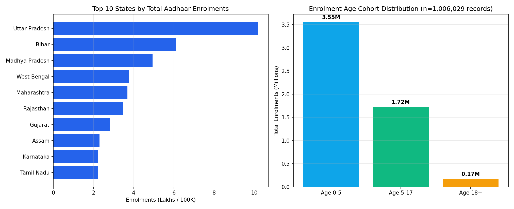
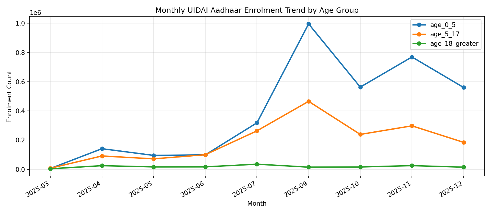

# UIDAI Aadhaar National Demographic & Enrolment Analytics

Large-scale Python Exploratory Data Analysis (EDA) and demographic trend analytics pipeline processing **4,938,837 UIDAI Aadhaar records** across **12 multi-part CSV datasets** spanning Biometric updates, Demographic updates, and New Enrolments.

---

## Overview

Analyzing multi-million-row public demographic datasets requires memory-conscious ingestion across sharded CSV exports, schema alignment (`dayfirst` date parsing and numeric coercion), identification of inconsistent administrative naming conventions, and segmented cohort analysis (`0-5`, `5-17`, `18+` years).

This repository packages clean Jupyter notebooks (stripped of bulky embedded Plotly widget blobs), a reproducible CLI analysis script ([`scripts/analyze_uidai.py`](scripts/analyze_uidai.py)), and summary visualizations computed directly from the 4.94M-row dataset.

---

## Key Verified Findings (`4,938,837` Total Records)

| Dataset Category | Source CSV Shards | Verified Row Count | Key Columns |
| :--- | :---: | :---: | :--- |
| **Biometric Updates** (`api_data_aadhar_biometric`) | `4` | **`1,861,108`** | `date`, `state`, `district`, `pincode`, `bio_age_5_17`, `bio_age_17_` |
| **Demographic Updates** (`api_data_aadhar_demographic`) | `5` | **`2,071,700`** | `date`, `state`, `district`, `pincode`, `demo_age_5_17`, `demo_age_17_` |
| **New Enrolments** (`api_data_aadhar_enrolment`) | `3` | **`1,006,029`** | `date`, `state`, `district`, `pincode`, `age_0_5`, `age_5_17`, `age_18_greater` |
| **Combined Total** | **`12`** | **`4,938,837`** | Multi-year, state, district & pincode granularity |

### Analytical Highlights

- **Enrolment Volume by Age Cohort (`1,006,029` enrolment rows / `5,435,702` total individuals):**
  - **Age `0-5`:** `3,546,965` (`65.25%` of total enrolments)
  - **Age `5-17`:** `1,720,384` (`31.65%`)
  - **Age `18+`:** `168,353` (`3.10%`)
- **Top 5 States by Total Enrolments:**
  1. Uttar Pradesh (`1,018,629`)
  2. Bihar (`609,585`)
  3. Madhya Pradesh (`493,970`)
  4. West Bengal (`375,297`)
  5. Maharashtra (`369,139`)
- **Data Quality Finding Identified:** Raw CSV exports contain `55–65` distinct `state` strings due to casing variations and legacy spellings (e.g., `West Bengal` vs `WEST BENGAL`), reinforcing the need for canonical state-name standardization before downstream BI aggregation.

---

## Visual Insights

### Top 10 States & Age Cohort Breakdown


### Monthly Enrolment Trend by Age Group


---

## Technology Stack

- **Data Ingestion & Wrangling:** Python 3, Pandas (`concat`, `to_datetime`, `to_numeric`)
- **Visualization:** Matplotlib, Seaborn, Plotly (`make_subplots`, interactive range sliders)
- **Environment:** Jupyter Notebook & CLI script

---

## Project Structure

```text
UIDAI-Aadhaar-Analytics/
├── .github/workflows/ci.yml                 # Automated syntax & notebook JSON validation
├── assets/
│   ├── uidai_state_and_age_summary.png      # Computed state & age cohort breakdown
│   └── uidai_monthly_enrolment_trend.png    # Computed monthly time-series trend
├── notebooks/
│   ├── uidai_demographic_analysis.ipynb     # Cleaned demographic EDA & Plotly notebook
│   └── uidai_enrolment_dashboard.ipynb      # Cleaned enrolment subplot dashboard notebook
├── scripts/
│   └── analyze_uidai.py                     # Reproducible CLI batch aggregation & chart generator
├── .gitignore                               # Excludes bulk raw CSVs (~260 MB) & >100 MB .pbix
├── requirements.txt
├── LICENSE
└── README.md
```

---

## Usage

*(Note: Raw CSV files [~260 MB] and the companion 107.7 MB Power BI workbook are excluded via `.gitignore` to stay within GitHub repository file limits. Place the `api_data_aadhar_*` CSV folders inside `data/` before running locally.)*

```bash
git clone https://github.com/yogesh-patil2003/UIDAI-Aadhaar-Analytics.git
cd UIDAI-Aadhaar-Analytics
pip install -r requirements.txt

python scripts/analyze_uidai.py --data-dir ./data --out-dir ./assets
```

---

## Roadmap

- Add canonical Indian state/UT normalization mapping (`dict` lookup table) inside `scripts/analyze_uidai.py` to collapse the `55–65` raw state variants down to official `36` States/UTs.
- Export aggregated summary tables (`state_summary.parquet` / CSV) for lightweight Power BI connection without loading raw 4.94M-row shards.

---

## License

MIT License — see [LICENSE](LICENSE).

## Author

**Yogesh Patil** — [@yogesh-patil2003](https://github.com/yogesh-patil2003) · [LinkedIn](https://www.linkedin.com/in/yogeshpatil2003/) · [Email](mailto:officialyogeshpatil0@gmail.com)
